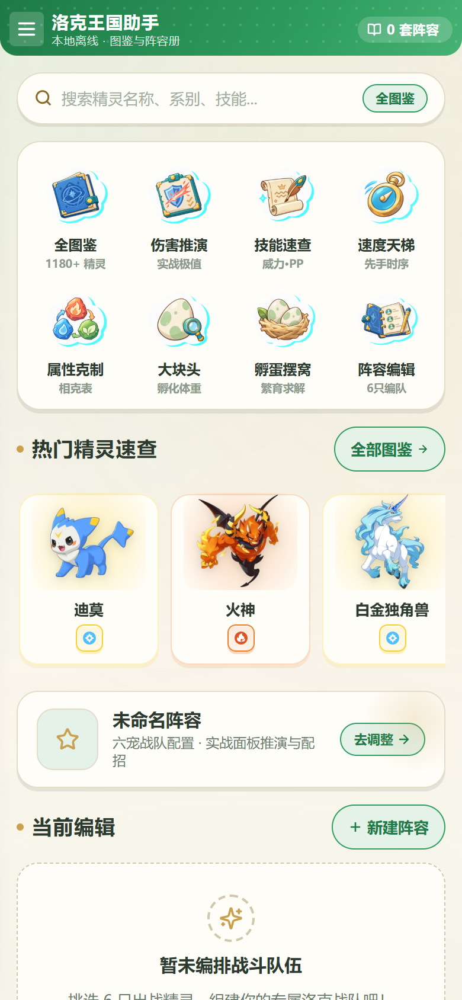
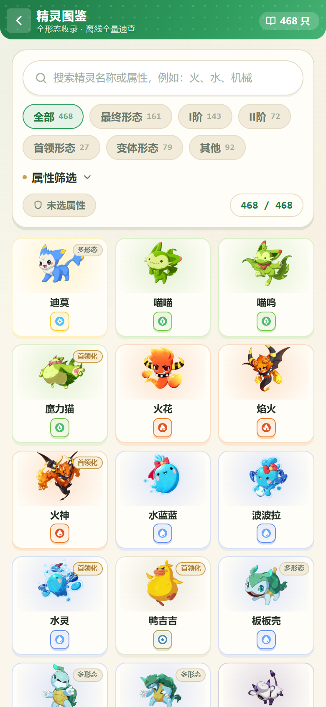
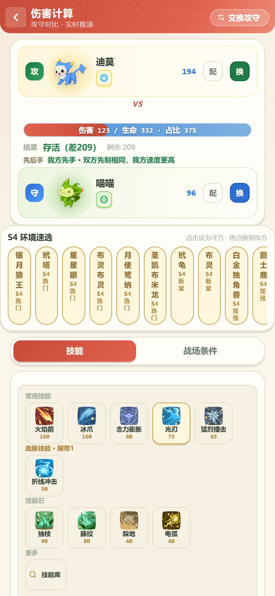
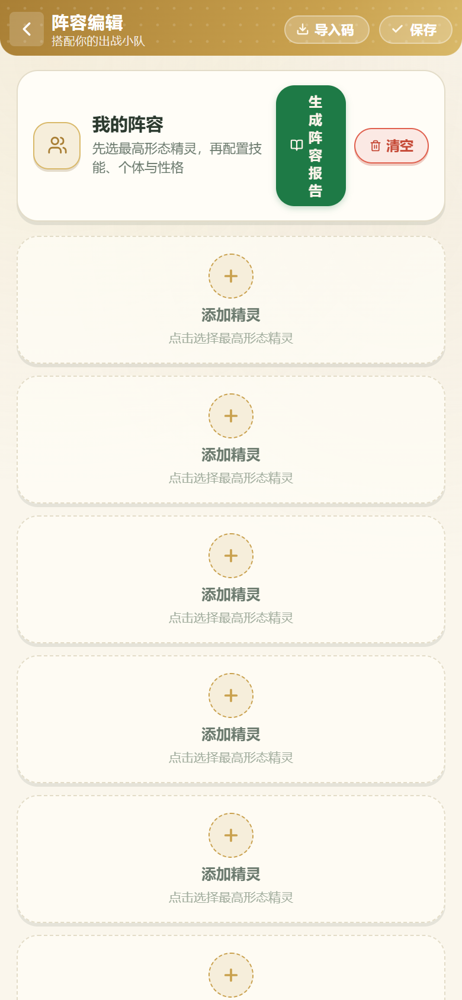
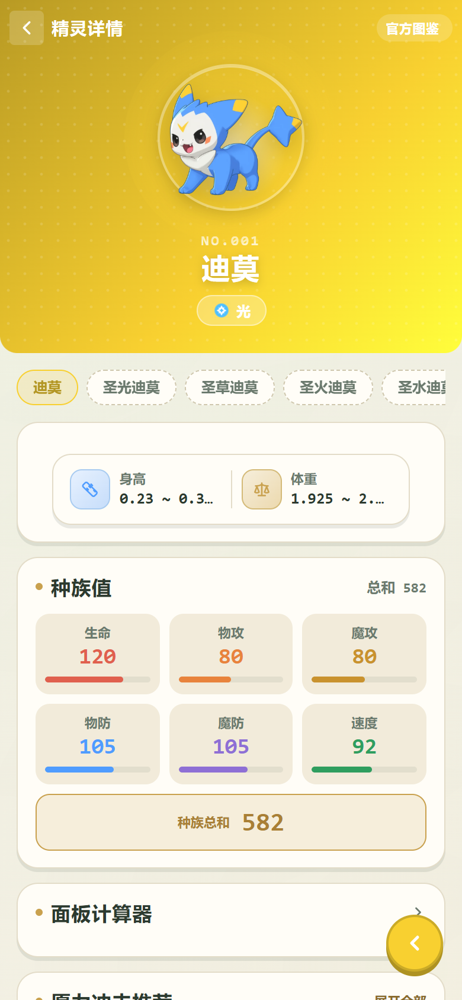
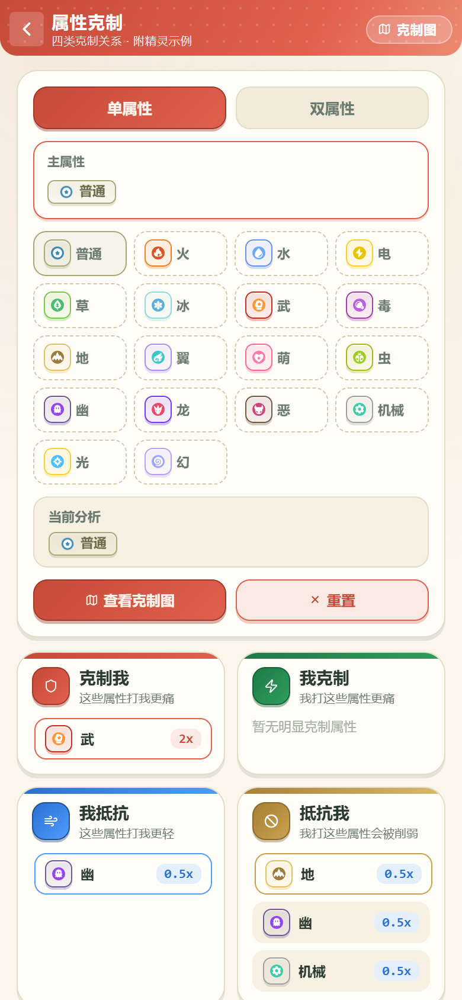
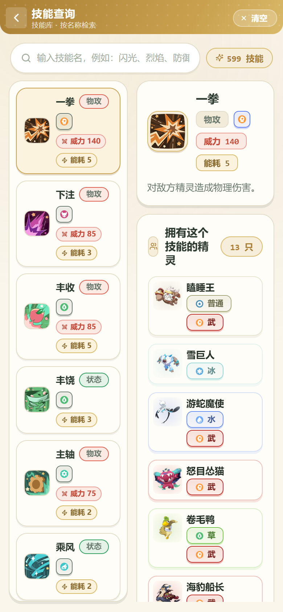
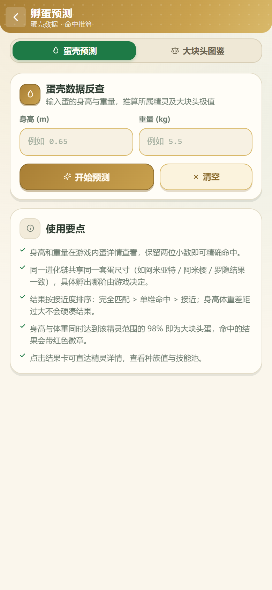
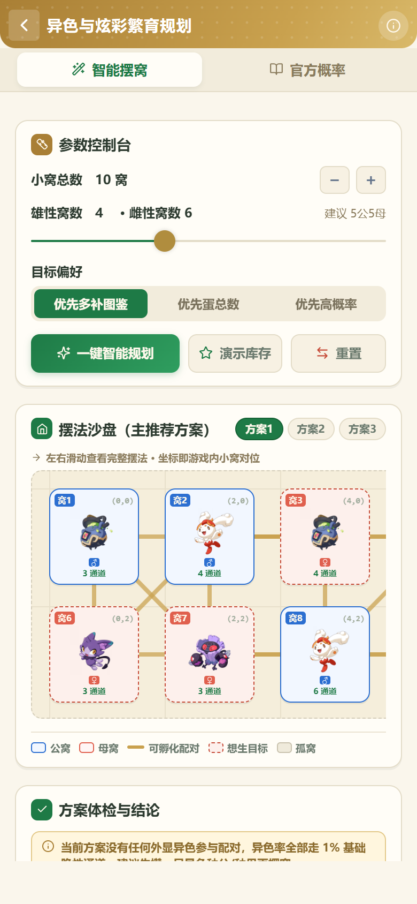

# 洛克王国：世界 小助手

> 一个为《洛克王国：世界》打造的离线本地助手，支持精灵图鉴、PVP 伤害推演、阵容编辑、孵蛋预测、繁育摆窝等功能。
> 基于 uni-app（Vue 3）开发，可运行于微信小程序、Android App、H5。

<p align="center">
  
  &nbsp;&nbsp;
  
  &nbsp;&nbsp;
  
  &nbsp;&nbsp;
  
</p>

## ✨ 主要功能

| 模块 | 说明 |
|------|------|
| **精灵图鉴** | 全形态收录，支持名称 / 属性 / 进化阶段筛选，离线速查 |
| **精灵详情** | 种族值、技能、特性、进化链、异色形态一站式查看 |
| **PVP 伤害推演** | 实时攻防对算，含技能选择、战场条件、先手判断、克制倍率 |
| **阵容编辑** | 六只战队配置，保存多套阵容，支持导入 / 导出分享码 |
| **阵容报告** | 当前面板与属性倍率快照，一图看懂队伍短板 |
| **属性克制** | 18 系相克表完整对照 |
| **技能查询** | 按技能名 / 属性 / 威力检索，支持按技能反向找精灵 |
| **速度排行** | 按速度种族值排序，快速判断出手顺序 |
| **孵蛋预测** | 蛋种体型计算，大块头判定（98 分位双维度） |
| **繁育摆窝** | 遗传技能沙盘规划，炫彩概率推算 |
| **悬浮窗** | 游戏内实时伤害悬浮球（Android 系统级 UTS 插件） |

## 📸 更多截图

<p align="center">
  
  &nbsp;
  
  &nbsp;
  
  &nbsp;
  
  &nbsp;
  
</p>

## 📂 项目结构

```
luokewangguo/
├── pages/                  # 页面（均在 pages.json 注册）
│   ├── index.vue           # 首页
│   ├── catalog.vue         # 精灵图鉴
│   ├── detail.vue          # 精灵详情
│   ├── pvp-breakpoint.vue  # PVP 伤害推演
│   ├── team-editor.vue     # 阵容编辑
│   ├── team-report.vue     # 阵容报告
│   ├── restriction.vue     # 属性克制
│   ├── skill-search.vue    # 技能查询
│   ├── speed-rank.vue      # 速度排行
│   ├── egg.vue             # 孵蛋预测
│   └── breeding-planner.vue# 繁育摆窝
│
├── components/             # 公共组件（easycom 自动注册）
├── data/                   # 数据文件（精灵 / 技能 / 克制表 / PVP 配置）
├── utils/                  # 工具函数（伤害引擎、阵容分析、热更新、分享码等）
├── crawler_official_api/   # 官方 API 数据抓取与生成（唯一数据入口）
├── scripts/                # 辅助脚本
├── uni_modules/            # UTS 插件（Android 悬浮窗）
└── static/float/           # 实时伤害悬浮窗页面
```

## 🔧 开发

### 环境要求

- Node.js ≥ 18
- HBuilderX（推荐 5.x，用于 uni-app 编译与打包）

### 数据更新

数据来自官方 API（wegame.shallow.ink），唯一入口是 `crawler_official_api/update_data.py`：

```bash
python crawler_official_api/update_data.py all    # 抓取 + 生成
python crawler_official_api/update_data.py apply  # 审核差异报告后应用
npm run build:float-data                          # 同步悬浮窗精简数据
```

### 测试

```bash
npm run test:pvp         # PVP 断点计算回归测试
npm run test:meta        # 环境元数据预览测试
npm run test:hotupdate   # 热更新端到端测试
```

## 📖 更多文档

- [项目说明](docs/README.md)
- [更新日志](docs/UPDATE_LOG.md)
- [AI 阅读地图](docs/AI_READING_MAP.md)
- [竞品与变现调研](docs/research/)

## 📄 License

ISC
